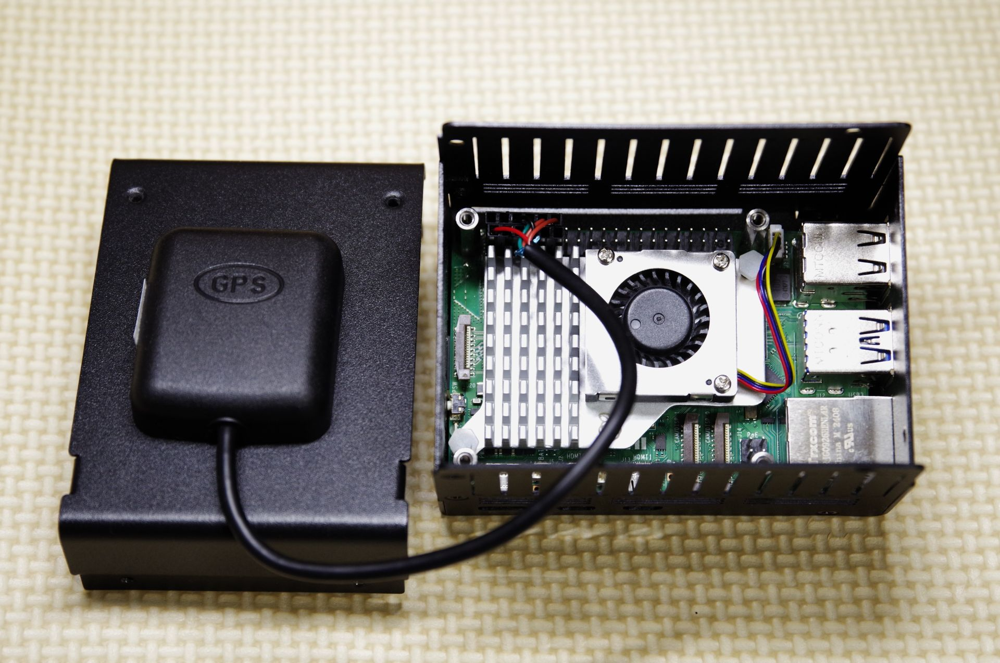

# OrionFieldStack v1.4.9

# 1. プロジェクト概要📝
OrionFieldStack は、Raspberry Pi 5を使用した、フィールドにおける天体撮影を支援する統合ツールキットです。自動撮影・データ取得のみならず、画像解析（プレートゾルビング）で、撮影した天体の位置を自動で割り出し、撮影データのスタッキングが可能です。

* リモート観測の自動化: VNCなどを利用して離れた場所から操作・監視が可能です。

## インストール手順 (Installation)

1. **リポジトリのクローン**
   以下のコマンドでリポジトリをクローンします。
   ```bash
   git clone https://github.com/voyager3stars/OrionFieldStack.git
   cd OrionFieldStack
   ```

### 【推奨】自動セットアップスクリプトを使用する場合

リポジトリ内のセットアップスクリプトを実行することで、システム要件のインストールから仮想環境の構築、必要なPythonパッケージのインストールまでを自動で行います。

```bash
chmod +x ofs_setup_env.sh
./ofs_setup_env.sh
```

---

### 手動でセットアップする場合

スクリプトを使用せず、手動で環境を構築する場合は以下の手順に従ってください。

2. **システム依存ライブラリのインストール**
   一部のパッケージ（`dbus-python`など）のビルドに必要なシステムライブラリをインストールします。
   ```bash
   sudo apt-get update
   sudo apt-get install -y libdbus-1-dev libglib2.0-dev
   ```

3. **仮想環境の作成と依存パッケージのインストール**
   Pythonの仮想環境（venv）を作成し、パッケージをインストールします。
   ```bash
   python3 -m venv venv
   source venv/bin/activate
   pip install -r requirements.txt
   ```

# 2. 構成モジュール📋
リポジトリ内は以下の主要コンポーネントで構成されています
| モジュール | 役割 | 概要 |
|:---|:---|:---|
| **ShutterPro03** | カメラ制御 | リレー回路によるシャッター制御とFlashAirを使ったデータ通信、INDI連携を統合し、USB制御に対応しないカメラでも高度な自動撮影を実現するツールです。OrionFieldStackプロジェクトの一環として、標準化された撮影ログを出力します。|
| **SkySolverEngine(SSE)** | 画像解析 | 撮影された画像ファイルをプレートゾルビングにより、正確な位置を取得し、標準化された撮影ログに追記します。|
| **SkySync** | 天体導入支援 | ShutterPro03、SSE、INDI通信を使い、赤道儀の向きを正確に同期させます。 |
| **StarFlux** | 画像解析 | 撮影された天体画像から星を検出し、その形状（FWHM：半値幅、楕円率）を統計的に解析し、画像のクオリティを定量化するツールです |
| **StarForge** | 画像処理 | `StarFlux` による画像品質解析の結果を活用し、複数の天体画像を自動的に位置合わせ・スタッキングするツールです。高品質なマスター FITS ファイルの生成を目的としています。 |
| **LogHarmonizer** | ログ管理 | 天体撮影ログのマスターデータである shutter_log.json と、編集・閲覧用の shutter_log.csv の間でデータの整合性を保ち、双方向に同期するためのツールです。OrionFieldStack JSON Specに完全準拠しており、ShutterPro03、SkySolverEngine (SSE)、StarFlux によって生成されたデータの管理を容易にします。 |
| **ExifScribe** | ログ管理 | ExifScribeは、撮影されたDNGファイルからEXIF情報を抽出し、`shutter_log.json` の該当レコードを補完または更新するためのツールです。OrionFieldStackのJSON Specに準拠し、記録漏れや情報の不一致を効率的に解消します。 |
| **ofs_link** | テレメトリリンク | INDIサーバーおよびGPSDから、望遠鏡架台（マウント）のステータス、赤経・赤緯、ピアーサイド、GPS位置情報、および高精度なタイムスタンプ情報を取得し、標準化されたJSON形式で出力するCUIツールです。|
| **ofs_gui** | 統合Web GUI | `shutterpro03` の撮影制御や `SSE` の画像解析などをブラウザから一元管理・操作するための、FastAPIベースの統合Webコントロールパネルです。|
| **ofs_map** | オフラインマップ管理 | OSMベースのオフラインマップのタイルデータ管理および、GPSと連動した高精度な位置・衛星情報のリアルタイム表示を行うWebサーバー兼CUIツールです。|
| **ofs_lcd** | LCDステータス表示 | Raspberry Pi 5 に接続された 1.3インチIPS液晶モジュール（AE-ATM0130B3 / ST7789V2 240x240）上で、OrionFieldStack のスプラッシュ起動画面（`ofs_start_view.py`）や、INDI・GPS・環境センサー・FlashAirのリアルタイム稼働テレメトリ（`ofs_status_view.py`）を高視認性で表示するモジュールです。|
| **imgfileharmonizer**| 画像・ログ整合 | 撮影ログ（JSON/CSV）とディスク上の画像ファイルの実体を突き合わせ、整合性の監査および不要ファイルの整理（ゴミ箱退避）を行うツールです。|
| **logmigrator** | ログ移行 | `shutter_log.json` の構造を、古いフォーマットから最新の v1.6.0 仕様へ安全に変換（マイグレーション）する移行用ツールです。|


# 3. 基本フォルダ構成🗃️
```text
~ (Home Directory)
├── OrionFieldStack/   # ===【プログラム層】==================================
│   ├── README.md               # プロジェクト全体の概要（本ファイル）
│   ├── requirements.txt        # 全モジュール共通の依存ライブラリリスト
│   ├── ofs_setup_env.sh        # 環境構築スクリプト
│   ├── start_ofs.sh            # 全システム一括起動スクリプト（LCD・Map・GUI）
│   │     

│   ├── shutterpro03/           # カメラ制御プログラム -----------------------
│   │   ├── README.md
│   │   ├── config.json         # 全体設定（接続先・パス・機材設定）
│   │   ├── shutterpro03.py     # メイン制御（エントリーポイント）
│   │   ├── sp03_utils.py       # 共通ユーティリティ（時間計算、パス変換等）
│   │   ├── sp03_logger.py      # ログ生成エンジン
│   │   ├── sp03_manual.md      # 詳細取扱説明書
│   │   └── OFS_json_spec.md    # ログファイルの仕様書
│   │
│   ├── SSE/                    # 画像解析プログラム（プレートゾルビング）-----
│   │   ├── README.md
│   │   ├── SSE.py              # メイン制御（エントリーポイント）
│   │   └── SSE_Technical_Spec.md
│   │
│   ├── skysync/                # 天体導入支援プログラム（自動同期）----------
│   │   ├── README.md
│   │   └── skysync.py          # メイン制御（エントリーポイント）
│   │　　  
│   ├── starflux/               # 画像のクオリティを定量化するツール ----------
│   │   ├── README.md
│   │   └── starflux.py         # メイン制御（エントリーポイント）
│   │　　  
│   ├── starforge/              # 複数の天体画像のスタッキングツール ----------
│   │   ├── README.md
│   │   ├── starforge.py        # メイン制御（エントリーポイント）
│   │   ├── sf_align.py
│   │   ├── sf_loader.py
│   │   └── sf_stack.py
│   │
│   ├── logharmonizer/          # ログファイルの整合・同期ツール -------------
│   │   ├── README.md
│   │   ├── logharmonizer1_6.py  # メイン制御（エントリーポイント）
│   │   └── config.json       　# デフォルトの保存場所の設定
│   │
│   ├── exifscribe/             # EXIF情報を抽出 ---------------------------
│   │   ├── README.md
│   │   └── exifscribe.py        # メイン制御（エントリーポイント）
│   │
│   ├── ofs_link/               # テレメトリリンクツール --------------------
│   │   ├── README.md
│   │   └── ofs_link.py          # メイン制御（位置情報管理・テレメトリ取得）
│   │
│   ├── ofs_gui/                # 統合Web GUIコントロールパネル -------------
│   │   ├── README.md
│   │   ├── app.py               # WebバックエンドAPI（エントリーポイント）
│   │   └── static/              # フロントエンドソース（HTML/CSS/JS）
│   │
│   ├── ofs_map/                # オフラインマップ＆GPS位置情報管理 ----------
│   │   ├── README.md
│   │   ├── app.py               # WebバックエンドAPI（マップ・GPS配信）
│   │   ├── ofs_map.py           # マップタイル管理CLI
│   │   ├── core/                # 地図同期・計算処理モジュール
│   │   └── static/              # フロントエンドソース（地図・衛星UI）
│   │
│   ├── ofs_lcd/                # 液晶ステータス表示プログラム ---------------
│   │   ├── README.md
│   │   ├── ofs_start_view.py   # 起動画面（スプラッシュロゴ）表示
│   │   ├── ofs_status_view.py  # リアルタイム通信・テレメトリステータス表示
│   │   ├── st7789.py           # ST7789V2 ディスプレイドライバ
│   │   └── set_bl.py           # バックライトPWM調光制御
│   │
│   ├── imgfileharmonizer/      # 画像ファイルとログの整合監査ツール ---------
│   │   ├── README.md
│   │   └── imgfileharmonizer1_6.py # メイン制御（エントリーポイント）
│   │
│   └── logmigrator/            # ログデータ構造移行ツール ------------------
│       ├── README_1_6.md
│       └── logmigrator_1_6.py   # メイン制御（エントリーポイント）
│   
├── Pictures/         # === 【撮影データ層】任意に設定可能 =====================
│   ├── IMG_XXXX.dng        # 撮影された生画像
│   ├── latest_shot.json    # ツール間連携用リアルタイムバッファ
│   ├── shutter_log.json    # 累積詳細ログ (JSON)
│   └── shutter_log.csv     # 閲覧用累積ログ (CSV)
│
└── ~/.local/share/   # === 【永続ユーザーデータ層】ワークスペース保護 =========
    ├── ofs/
    │   └── location.json   # 観測地位置情報（ofs_linkが一元管理・手動/GPSフォールバック）
    └── ofs_map_data/
        ├── regions.json    # マップ領域定義
        └── tiles/          # オフライン地図キャッシュ
```


# 4. ハードウェア構成⚙️
カメラのシャッター制御は、RPiから直接信号を送るのではなく、フォトカプラ（PC817）を介してカメラのレリーズ端子を短絡させます。また、IPS液晶（AE-ATM0130B3）のバックライトPWM調光は、ゲート保護抵抗・プルダウン抵抗を備えたNch MOSFET（2N7000）を介して制御します。

## 4.1 配線図

```text
Raspberry Pi 5 (GPIO Header)               External Components
    ___________________                ____________________________
   |                   |              |      [ GPS Module ]        |
   | (Pin 1) [3.3V] ●--|--------------|--● [VCC]                   |
   | (Pin 6) [GND]  ●--|--------------|--● [GND]                   |
   | (Pin 8) [TXD]  ●--|--------------|--● [RX] (Cross)            |
   | (Pin 10)[RXD]  ●--|--------------|--● [TX] (Cross)            |
   | (Pin 12)[GP18] ●--|--------------|--● [PPS] (1PPS Pulse)      |
   |                   |              |____________________________|
   |                   |               ____________________________
   |                   |              |   [ PC817 Photocoupler ]   |
   |                   |              |                            |
   | (Pin 13)[GP27] ●--|----[220Ω]----|--● (Pin 1)[A]    (Pin 4)●--|---> [Camera Shutter]
   |                   |              |                            |
   | (Pin 14)[GND]  ●--|--------------|--● (Pin 2)[C]    (Pin 3)●--|---> [Camera Common]
   |                   |              |____________________________|
   |                   |               ____________________________
   |                   |              |  [ AE-ATM0130B3 IPS LCD ]  |
   | (Pin 1) [3.3V] ●--|--------------|--● (Pin 1)[VDD]            |
   | (Pin 17)[3.3V] ●--|--------------|--● (Pin 2)[VDDIO]          |
   | (Pin 6) [GND]  ●--|--------------|--● (Pin 3)[GND]            |
   | (Pin 23)[GP11] ●--|--------------|--● (Pin 4)[SCK]  (SPI0)    |
   | (Pin 19)[GP10] ●--|--------------|--● (Pin 5)[MOSI] (SPI0)    |
   | (Pin 24)[GP8]  ●--|--------------|--● (Pin 6)[/CS]  (SPI0)    |
   | (Pin 22)[GP25] ●--|--------------|--● (Pin 7)[D/C]            |
   | (Pin 18)[GP24] ●--|--------------|--● (Pin 8)[/RES]           |
   |                   |              |            ▲               |
   |                   |              |    [BL (Backlight)]        |
   |                   |              |            | (D: Drain)    |
   | (Pin 16)[GP23] ●--|----[100Ω]----+--● (G) [2N7000]            |
   |                   |              |            | (S: Source)   |
   |                   |           [10kΩ]          |               |
   | (Pin 6) [GND]  ●--|--------------+------------+               |
   |___________________|              |____________________________|
    
    ● = Connected pins / (Pin #) = Physical Pin Number
```
| ピン番号 (Physical) | 名前 | 役割 |
|:---|:---|:---|
| **1, 17 (3.3V) / 2 (5V) / 6, 14 (GND)** | Power | `GPSモジュール、リレー回路、IPS液晶モジュールへの電源供給` |
| **8 (GPIO 14 / TX)** | UART TX | `gps-setup: GPSモジュールへの設定送信` |
| **10 (GPIO 15 / RX)** | UART RX | `gps-setup: GPSデータの受信` |
| **12 (GPIO 18 / PPS)** | GPIO In | `pps-gpio: GPSモジュールからの高精度1PPS時刻同期パルス入力` |
| **13 (GPIO 27)** | GPIO Out | `shutterpro03: カメラシャッター切替え（フォトカプラ経由）` |
| **16 (GPIO 23)** | PWM Out | `ofs_lcd: 液晶バックライトPWM調光制御（保護抵抗100Ω・プルダウン抵抗10kΩ・2N7000経由）` |
| **18 (GPIO 24)** | GPIO Out | `ofs_lcd: 液晶ハードウェアリセット (/RES)` |
| **19 (GPIO 10 / MOSI)** | SPI0 MOSI | `ofs_lcd: 液晶SPIデータ送信` |
| **22 (GPIO 25)** | GPIO Out | `ofs_lcd: 液晶データ/コマンド切替 (D/C)` |
| **23 (GPIO 11 / SCLK)** | SPI0 SCLK | `ofs_lcd: 液晶SPIクロック` |
| **24 (GPIO 8 / CE0)** | SPI0 CE0 | `ofs_lcd: 液晶チップセレクト (/CS)` |

## 4.2 外観💻


## 5. 更新履歴 (Changelog) 🔄
### v1.4.9 (2026-11-01)
- **ofs_lcd (1.3インチIPS液晶モジュールによるステータス・テレメトリ表示機能の実装・拡張)**
  - **リアルタイムテレメトリ表示 (`ofs_status_view.py`)**: Web GUIのダッシュボードデザインに準拠した2カラム・5セクション構成（`INDI STATUS`, `TIME`, `GPS`, `ENVIRONMENT`, `FLASH AIR`）のライブステータス画面を実装。`ofs_gui` APIおよび `ofs_link` と連携し、マウント状態、現地/UTC時刻、GPS座標・GPSD状態、気温・湿度・気圧・露点・CPU温度（Mount/RPi）・ピアー方向、FlashAir接続状態をリアルタイム描画。
  - **スプラッシュ起動画面 (`ofs_start_view.py` / `ofs_lcd.py`)**: 起動時にプロジェクトロゴとバージョン・システム稼働準備完了ステータスを指定秒数表示するスタート画面を実装。
  - **Raspberry Pi 5 最適化ドライバ (`st7789.py` / `set_bl.py`)**: RPi 5のRP1チップ（`gpiod` / `lgpio` / `spidev`）と `NumPy` ベクトル演算による高速RGB565変換・チャンク転送を実装。PPS等で使用する他ピンに干渉しない最小SPIピン構成（`spi0-1cs,no_miso`）と、ハードウェア支援PWMによる0〜100%のバックライト調光および終了時の完全消灯処理に対応。
  - **一括起動スクリプト (`start_ofs.sh`) の追加**: 起動画面の表示からライブステータス画面の常駐、`ofs_map` および `ofs_gui` の起動までを一括実行する起動スクリプトを整備。

### v1.4.8 (2026-10-10)
- **ofs_gui (SHUTTERリアルタイムプレビュー＆高速サムネイル配信)**
  - **リアルタイム撮影プレビュー（Shot Preview）**: Shutter画面のコントロールパネル下部に撮影画像の自動プレビューカードを追加。ON/OFFトグルスイッチ、主要EXIF・撮影メタデータ（露出、ISO、ターゲット、撮影時刻等）の表示、およびモーダル拡大ズーム表示に対応。
  - **高速軽量サムネイル＆キャッシュ最適化**: プレビュー枠に合わせてサーバー側で高速リサイズ（Pillowの`draft()`およびDNG内蔵サムネイル抽出）を行い、転送データ量を1/100以下（数十KB）に縮小。ディスクキャッシュ（`~/.cache/ofs/`）と更新日時ベースのブラウザキャッシュにより、即時（0秒）描画を実現。
- **skysync (パス解決の堅牢化と共通仮想環境対応)**
  - **リポジトリルート動的検出**: スクリプト配置場所（`__file__`）からリポジトリルートを自動導出し、インストール先ディレクトリ名や配置場所に関わらず動作するよう改善（v2.1.2）。
  - **共通仮想環境優先**: リポジトリ直下の共通仮想環境（`venv`）を優先利用し、外部ライブラリのインポートエラーを解消。

### v1.4.7
- **位置情報管理構造の刷新 (ofs_link / ofs_map / shutterpro03)**
  - **位置情報保存の一元化**: 複数存在していた `config.json` 間の位置情報（`LAST_LATITUDE` 等）の二重管理を解消し、システム全体の観測地情報を `~/.local/share/ofs/location.json` に一本化しました。
  - **`ofs_link` への権限集約**: `ofs_link` を位置情報の単一管理モジュール（窓口）と位置付け、`--set-location` および `--get-location` コマンドを追加。`ofs_map` の「現在地として登録」機能も `ofs_link` 経由で安全に保存するように変更しました。
  - **設定ファイルと状態データの完全分離**: `ofs_link/config.json` を廃止（設定は `shutterpro03/config.json` を参照）。また、`shutterpro03/config.json` 内に混在していた動的位置データ（`LAST_*`）を削除し、位置フォールバックは `ofs_link.load_location()` を参照する構造へとリファクタリングしました（初回起動時に自動移行）。

### v1.4.6
- **ofs_map (オフラインマップ＆GPS連携強化)**
  - **GPS Map & Telemetry UIの刷新**: 画面を左右50%ずつに分割し、右側にGPS専用のマップ、高度なテレメトリー情報、衛星一覧を機能的に配置しました。
  - **超高精度PPS時刻オフセット表示**: GPSからのPPS信号を解析し、ローカル時間とGPS実時間との誤差をナノ秒精度で計算・可視化できるようになりました。
  - **GPS衛星情報の可視化・フリッカー防止**: 各衛星の仰角・方位角から直下点（サブサテライトポイント）を計算しリアルタイムマッピング。また、データの一時的な欠落による画面の点滅を防ぐため、UI側でデータを約30秒間キャッシュするフリッカー防止機能を搭載しました。
  - **広域マップ管理**: Zoom 0〜3等の広域マップデータの一括ダウンロード機能を追加し、データ保護の観点からタイル画像の保存先をシステムワークスペース外の `~/.local/share/ofs_map_data/` に一元管理しました。

### v1.4.5
- **ofs_gui / starforge (フラット補正の強化とバグ修正)**
  - **Flat Multiplier設定の追加**: ofs_guiのStarforgeタブのCalibration Settings（Flat Calibration枠）から、フラット補正の乗数（Multiplier Mode: manual, auto_ccr, auto_fit 等）と数値を指定できるようになりました。
  - **StarforgeのJSONパース修正**: `auto_ccr` 等で背景画像 (bg_image) を正しく参照できずエラーとなる不具合を修正しました（JSONログの `analysis` 階層パスの誤りを修正）。

### v1.4.4
- **ofs_gui (Starforge機能連携の強化)**
  - **Flat View画面の拡張**: Flat View画面の左側ペインに「STACKED FILE」セクションを追加し、生成済みのマスターフラットファイル（FITS等）を直接選択・プレビューできるようになりました。
  - **出力先フォルダのフォールバック**: StarforgeタブでOutput Directoryが指定されていない場合でも、自動的に元の画像ディレクトリからスタック済みファイルを検索するようにバックエンドロジックを改善しました。
  - **セッション一覧の視認性向上**: Starforgeタブのセッションリストにおいて、スタック済みFITファイルが存在するかを示すインジケーターを拡張しました。ファイル名に基づいて「Color」や「Mono」などのバッジを動的に表示し、一目でデータ種別を判別できるようになりました。

## ⚖️ License
© 2026 OrionFieldStack Project / MIT License

Official Web: [voyager3.stars](https://voyager3.stars.ne.jp)
